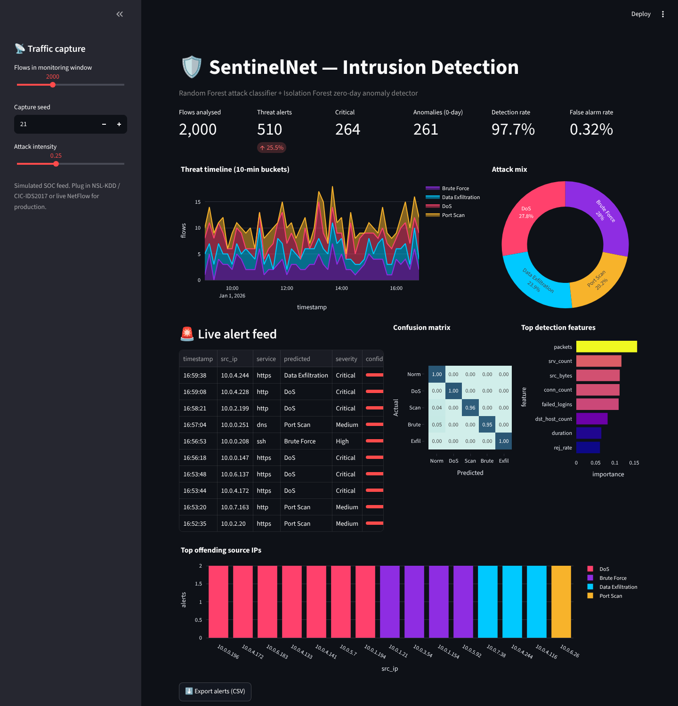
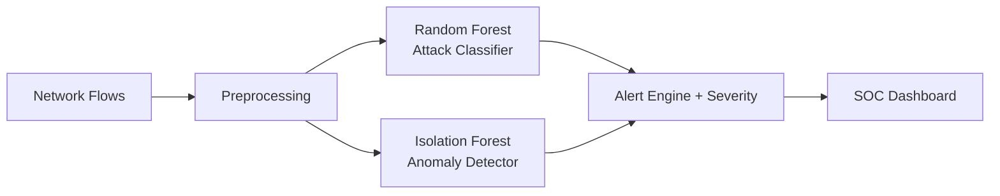

<div align="center">

# 🛡️ SentinelNet — ML Network Intrusion Detection System

**A SOC-style dashboard that detects DoS, port scans, brute force and data exfiltration in network flows.**

    

`Cybersecurity · Machine Learning`

</div>

---



## 📌 Problem Statement

Signature-based firewalls miss new and stealthy attacks. ML models learn traffic behaviour and flag both known attacks and anomalies.

## ✨ Key Features

- Network-flow simulator with **NSL-KDD / CIC-IDS style features** and stealthy low-and-slow attack variants
- **Random Forest** multi-class attack classifier (class-balanced)
- **Isolation Forest** anomaly detector trained only on normal traffic (zero-day detection)
- KPIs: detection rate, false-alarm rate, critical alerts
- Threat timeline, attack mix, live **alert feed with severity**, top offending IPs
- Confusion matrix, feature importance and CSV alert export

## 🏗️ Architecture



## ⚙️ How It Works

1. Five traffic classes are generated from realistic flow statistics (packets, bytes, SYN-error rate, reject rate, failed logins…).
2. A `ColumnTransformer` scales numeric and one-hot encodes protocol / service / flag features.
3. The classifier labels each flow; an independent Isolation Forest flags flows that deviate from normal behaviour.
4. Alerts are mapped to severities and aggregated for the SOC view.

## 🧰 Tech Stack

| Layer | Tools |
|---|---|
| Language | Python 3.10+ |
| ML / Logic | pandas, numpy, scikit-learn |
| UI & Visualisation | Streamlit, Plotly |

## 📁 Project Structure

```
NETWORK-INTRUSION-DETECTION/
├── app.py             # SOC dashboard
├── ids.py             # Flow simulation, training, evaluation, scoring
├── assets/              # screenshots
├── requirements.txt
└── README.md
```

## 🚀 Getting Started

```bash
git clone https://github.com/PreciousBharath/NETWORK-INTRUSION-DETECTION.git
cd NETWORK-INTRUSION-DETECTION
python -m venv venv && source venv/bin/activate   # Windows: venv\Scripts\activate
pip install -r requirements.txt
streamlit run app.py
```

Open **http://localhost:8501** in your browser.

> The project ships with a realistic built-in demo dataset, so it runs out of the box with no downloads or API keys.

## 🗺️ Roadmap

- [ ] Train on CIC-IDS2017 / UNSW-NB15
- [ ] Live capture with Scapy / Zeek logs
- [ ] Slack / email alerting

## 👨‍💻 Author

**Bharath** — Software Developer · Project Engineer · Technical Trainer

[](https://linkedin.com/in/connectbharath)
[](https://itsbharathportfolio.netlify.app)
[](https://github.com/PreciousBharath)

⭐ If this project helped you, please give it a star!

## 📄 License

Released under the [MIT License](LICENSE).
